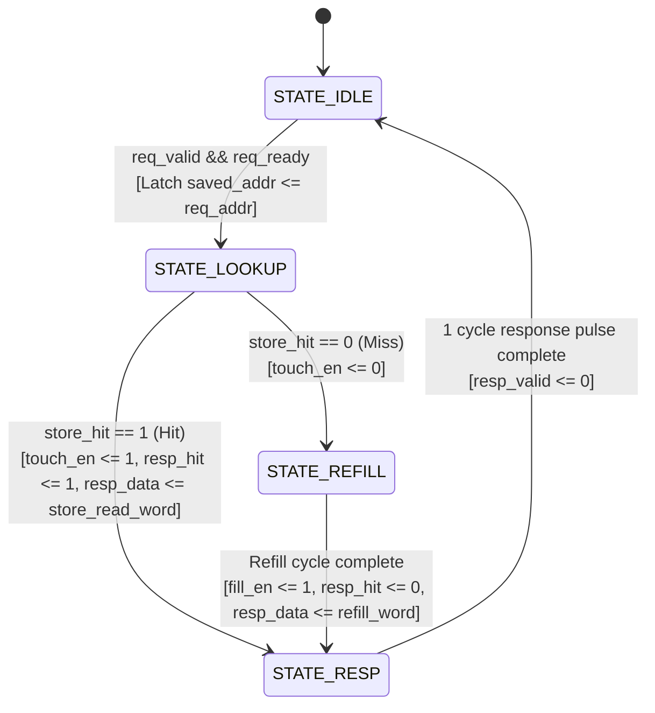

# 2-Way Set-Associative Cache Architecture & Datapath Specification

This document provides a comprehensive architectural breakdown and structural block diagrams for the synthesizable 2-Way Set-Associative Cache (`cache_2way`) and its internal storage submodule (`cache_2way_store`).

---

## 1. Architectural Overview & Geometry

The cache provides 128 bytes of total data storage organized into 4 sets with 2 ways per set:
- **Total Capacity**: 128 bytes (1024 bits).
- **Block Size**: 16 bytes (128 bits), containing four 32-bit words.
- **Set Count**: 4 sets ($2^2 \implies \text{Index} = \text{addr}[5:4]$).
- **Associativity**: 2 ways per set (Way 0 and Way 1).
- **Tag Width**: 26 bits ($\text{addr}[31:6]$).
- **Word Select**: 2 bits ($\text{addr}[3:2]$).
- **Byte Offset**: 2 bits ($\text{addr}[1:0] == 2\text{'b}00$ for aligned 32-bit reads).

```
 31                                                6 5     4 3     2 1     0
+---------------------------------------------------+-------+-------+-------+
|                        TAG                        |  SET  | WORD  | BYTE  |
|                      [31:6]                       | [5:4] | [3:2] | [1:0] |
+---------------------------------------------------+-------+-------+-------+
                       26 bits                        2 bits  2 bits  2 bits
                                                     (4 sets)(4 wds) (offset)
```

---

## 2. Top-Level Datapath & Controller Block Diagram

```
========================================================================================================================
                                                  CACHE_2WAY TOP LEVEL
========================================================================================================================

    Master Request Port                                                    Master Response Port
   ---------------------                                                  ----------------------
   req_valid ---------->+----------------------------------------------+---------> resp_valid (1-cycle pulse)
   req_addr[31:0] ----->|                   CONTROLLER                 |---------> resp_hit   (1 = Hit, 0 = Miss)
                        |                      FSM                     |---------> resp_data[31:0]
   req_ready <----------+ (IDLE, LOOKUP, REFILL, RESP)                 |
                        |                                              |
                        | Latches saved_addr[31:0] on handshake        |
                        +----------------------+-----------------------+
                                               |
                     +-------------------------+-------------------------+
                     | saved_addr[31:0]                                  |
                     v                                                   v
   +------------------------------------+             +--------------------------------------+
   |          LOWER MEMORY PORT         |             |      REFILL WORD MULTIPLEXER         |
   |                                    |             |                                      |
   | mem_block_addr[31:0] =             |             | Selects word from mem_block_data:    |
   |   {saved_addr[31:4], 4'b0000}      |             |   00 -> Word 0 [31:0]                |
   |                                    |             |   01 -> Word 1 [63:32]               |
   | mem_block_data[127:0] <----------- |             |   10 -> Word 2 [95:64]               |
   +-----------------+------------------+             |   11 -> Word 3 [127:96]              |
                     |                                +------------------+-------------------+
                     | 128-bit refill block                              | refill_word[31:0]
                     v                                                   v
+-----------------------------------------------------------------------------------------------------------------------+
|                                              CACHE_2WAY_STORE SUBMODULE                                               |
|                                                                                                                       |
|   addr[31:0] = saved_addr[31:0]                                                                                       |
|   tag_in = saved_addr[31:6], set_idx = saved_addr[5:4], word_sel = saved_addr[3:2]                                    |
|                                                                                                                       |
|     +----------------------------------+             +----------------------------------+                             |
|     |              WAY 0               |             |              WAY 1               |                             |
|     | Valid Array: valid_way0[3:0]     |             | Valid Array: valid_way1[3:0]     |                             |
|     | Tag RAM:     tag_way0[3:0][25:0] |             | Tag RAM:     tag_way1[3:0][25:0] |                             |
|     | Data RAM:    data_way0[3:0][127] |             | Data RAM:    data_way1[3:0][127] |                             |
|     +-----------------+----------------+             +-----------------+----------------+                             |
|                       |                                                |                                              |
|                       | [Tag0, Valid0]                                 | [Tag1, Valid1]                               |
|                       v                                                v                                              |
|            +--------------------+                           +--------------------+                                    |
|            |   TAG COMPARATOR   |                           |   TAG COMPARATOR   |                                    |
|            | tag_way0 == tag_in |                           | tag_way1 == tag_in |                                    |
|            |  && valid_way0     |                           |  && valid_way1     |                                    |
|            +---------+----------+                           +---------+----------+                                    |
|                      | way0_match                                     | way1_match                                    |
|                      +-----------------------+ +----------------------+                                               |
|                                              | |                                                                      |
|                                              v v                                                                      |
|                                   +-----------------------+                                                           |
|                                   |   HIT & WAY DECODER   |                                                           |
|                                   |  hit = M0 || M1       |                                                           |
|                                   |  hit_way = M1 ? 1 : 0 |                                                           |
|                                   +-----------+-----------+                                                           |
|                                               |                                                                       |
|                       +-----------------------+-----------------------+                                               |
|                       | hit, hit_way                                  | hit_way                                       |
|                       v                                               v                                               |
|            +---------------------+                         +---------------------+                                    |
|            |   LRU REPLACEMENT   |                         |    WAY DATA MUX     |                                    |
|            |   & VICTIM LOGIC    |                         | Data0 vs Data1      |                                    |
|            |                     |                         +----------+----------+                                    |
|            | lru_bit[3:0] (1/set)|                                    | 128-bit hit block                             |
|            | Priority:           |                                    v                                               |
|            |  1. Empty Way 0     |                         +---------------------+                                    |
|            |  2. Empty Way 1     |                         |  CACHED WORD MUX    |                                    |
|            |  3. lru_bit[set]    |                         | word_sel = addr[3:2]|                                    |
|            +----------+----------+                         +----------+----------+                                    |
|                       |                                               | store_read_word[31:0]                         |
+-----------------------|-----------------------------------------------|-----------------------------------------------+
                        | victim_way                                    |
                        v                                               v
              +-------------------+                          +---------------------+
              | REFILL TARGET MUX |                          |  RESP DATA SELECT   |
              | Routes fill_block |                          | Hit: store_read_word|
              | to victim way RAM |                          | Miss: refill_word   |
              +-------------------+                          +----------+----------+
                                                                        |
                                                                        v resp_data[31:0]
```

---

## 3. Structural Datapath Details

```mermaid
flowchart TD
    subgraph MasterInterface ["Master Interface"]
        REQ["req_valid, req_addr[31:0]"]
        READY["req_ready"]
        RESP["resp_valid, resp_hit, resp_data[31:0]"]
    end

    subgraph Controller ["Cache Controller FSM"]
        FSM["FSM Engine<br/>(IDLE / LOOKUP / REFILL / RESP)"]
        SAVED["saved_addr Register<br/>(latches req_addr)"]
    end

    subgraph MemoryModel ["Lower Memory (mem_block_model)"]
        MEM_ADDR["mem_block_addr[31:0] = {saved_addr[31:4], 4'b0000}"]
        MEM_DATA["mem_block_data[127:0]"]
    end

    subgraph Storage ["cache_2way_store"]
        subgraph Arrays ["Way 0 & Way 1 Storage (4 Sets)"]
            W0["Way 0<br/>Valid[3:0]<br/>Tag[3:0][25:0]<br/>Data[3:0][127:0]"]
            W1["Way 1<br/>Valid[3:0]<br/>Tag[3:0][25:0]<br/>Data[3:0][127:0]"]
            LRU["LRU Registers<br/>lru_bit[3:0] (1 bit / set)"]
        end

        subgraph TagMatch ["Parallel Tag Comparison"]
            CMP0["Comparator Way 0<br/>valid_way0 && (tag0 == tag_in)"]
            CMP1["Comparator Way 1<br/>valid_way1 && (tag1 == tag_in)"]
            HIT["Hit Logic<br/>hit = way0_match || way1_match<br/>hit_way = way1_match ? 1 : 0"]
        end

        subgraph VictimSel ["Victim Selection"]
            VICTIM["Victim Logic<br/>1. Empty Way 0 Priority<br/>2. Empty Way 1 Priority<br/>3. lru_bit[set] when full"]
        end

        subgraph CachedWord ["Cached Word Selection"]
            WAY_MUX["Way Mux (Data0 vs Data1)"]
            WORD_MUX["Word Mux (addr[3:2])"]
        end
    end

    subgraph RefillDatapath ["Refill Datapath"]
        REFILL_MUX["Refill Word Mux<br/>mem_block_data[addr[3:2]]"]
    end

    REQ -->|Handshake| FSM
    FSM -->|Latch| SAVED
    FSM --> READY
    SAVED --> MEM_ADDR
    MEM_ADDR --> MEM_DATA

    SAVED -->|set_idx, tag_in, word_sel| Storage
    W0 --> CMP0
    W1 --> CMP1
    CMP0 --> HIT
    CMP1 --> HIT

    W0 --> WAY_MUX
    W1 --> WAY_MUX
    HIT -->|hit_way| WAY_MUX
    WAY_MUX --> WORD_MUX

    W0 --> VICTIM
    W1 --> VICTIM
    LRU --> VICTIM

    FSM -->|touch_en| LRU
    FSM -->|fill_en| Arrays
    MEM_DATA -->|fill_block| Arrays
    MEM_DATA --> REFILL_MUX

    WORD_MUX -->|store_read_word (Hit)| RESP
    REFILL_MUX -->|refill_word (Miss)| RESP
    FSM -->|resp_valid, resp_hit| RESP
```

---

## 4. Cache Controller Finite State Machine (FSM)

The controller FSM sequences each accepted request through four discrete states:



### State Specifications

1. **`STATE_IDLE` (`2'b00`)**:
   - `req_ready = (!rst)`: Ready to accept incoming master requests.
   - `resp_valid = 0`.
   - On `req_valid && req_ready`: Latches `saved_addr <= req_addr`, deasserts `req_ready` on the next cycle, and advances to `STATE_LOOKUP`.

2. **`STATE_LOOKUP` (`2'b01`)**:
   - Evaluates `store_hit` combinatorially on `saved_addr`.
   - **On Hit (`store_hit == 1`)**:
     - Asserts `touch_en = 1` for this cycle, causing `cache_2way_store` to update `lru_bit[set_idx]` to point to the *other* way as the next victim.
     - Registers `resp_valid <= 1`, `resp_hit <= 1`, and `resp_data <= store_read_word`.
     - Transitions directly to `STATE_RESP`.
   - **On Miss (`store_hit == 0`)**:
     - Keeps `touch_en = 0`.
     - Transitions to `STATE_REFILL`.

3. **`STATE_REFILL` (`2'b10`)**:
   - Asserts `fill_en = 1` for this cycle.
   - `cache_2way_store` writes `mem_block_data` into `victim_way` at `saved_addr[5:4]`, updates valid and tag registers, and flips `lru_bit[set_idx]` away from the newly refilled way.
   - Registers `resp_valid <= 1`, `resp_hit <= 0` (preserving original miss classification), and `resp_data <= refill_word` (selected from `mem_block_data` using `saved_addr[3:2]`).
   - Transitions to `STATE_RESP`.

4. **`STATE_RESP` (`2'b11`)**:
   - Holds `resp_valid = 1`, `resp_hit`, and `resp_data` for the master to sample on the rising clock edge.
   - Deasserts `resp_valid <= 0` and returns to `STATE_IDLE`.

---

## 5. Architectural Invariants Enforced

1. **Address Latching & Bus Isolation**:
   - The cache latches `req_addr` into `saved_addr` upon acceptance.
   - Mutating `req_addr` during `LOOKUP`, `REFILL`, or `RESP` has zero effect on the in-flight access, tag lookup, or memory refill base address.

2. **Single Outstanding Request Protocol**:
   - `req_ready` remains strictly low from the cycle after request acceptance until `STATE_RESP` completes and the FSM returns to `STATE_IDLE`.

3. **Single Recency Update Per Transaction**:
   - Hit transactions update LRU recency exclusively via `touch_en` in `STATE_LOOKUP`.
   - Miss transactions update LRU recency exclusively via `fill_en` in `STATE_REFILL`.
   - `touch_en` and `fill_en` are provably mutually exclusive:
     $$\text{touch\_en} \land \text{fill\_en} = 0 \quad \forall \, t$$

4. **True Hit/Miss Preservation**:
   - Responses for cache misses always report `resp_hit = 0`, even though the cache is refilled before response delivery.

---

## 6. Reproducible Verification Commands

Both the localized storage unit test and the top-level integration test suite can be executed with automated shell scripts from the repository root:

```bash
# 1. Run Krishna's 2-way storage unit tests (51 assertions)
./scripts/run_store_unit_test.sh

# 2. Run Apoorva's top-level integration tests (141 assertions)
./scripts/run_cache_2way_integration_test.sh

# Alternatively, manual iverilog invocation for integration tests:
iverilog -g2012 -Wall -s tb_cache_2way -o sim_cache_2way.vvp \
    rtl/cache_2way.v rtl/cache_2way_store.v tb/mem_block_model.v tb/tb_cache_2way.sv
vvp sim_cache_2way.vvp
rm -f sim_cache_2way.vvp
```

### Reusable Memory Verification Model
The deterministic block memory model is located at:
`tb/mem_block_model.v`

It implements the binding algorithmic memory rule:
$$\text{Memory}[\text{word\_addr}] = \text{word\_addr}$$
and is fully decoupled from the cache controller, ready for reuse by **Prachee** in baseline direct-mapped cache verification (`cache_direct`).
